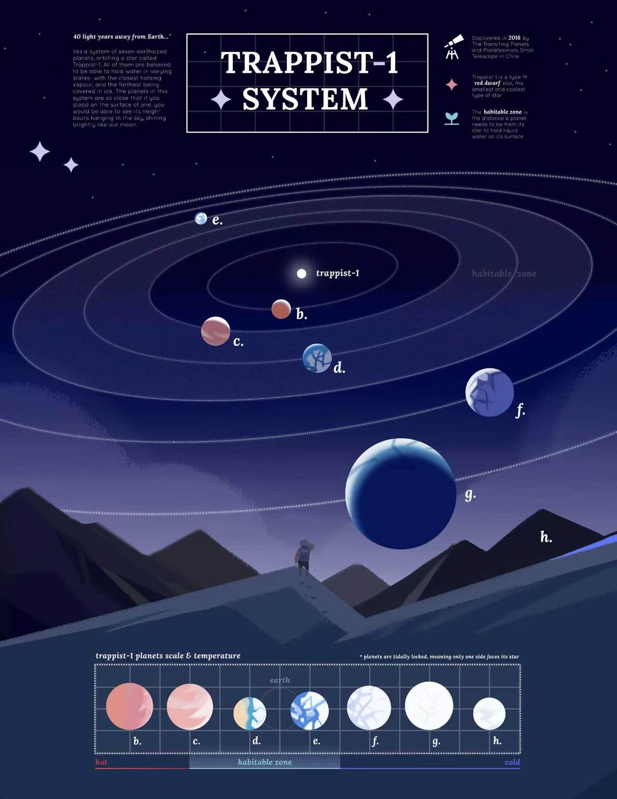
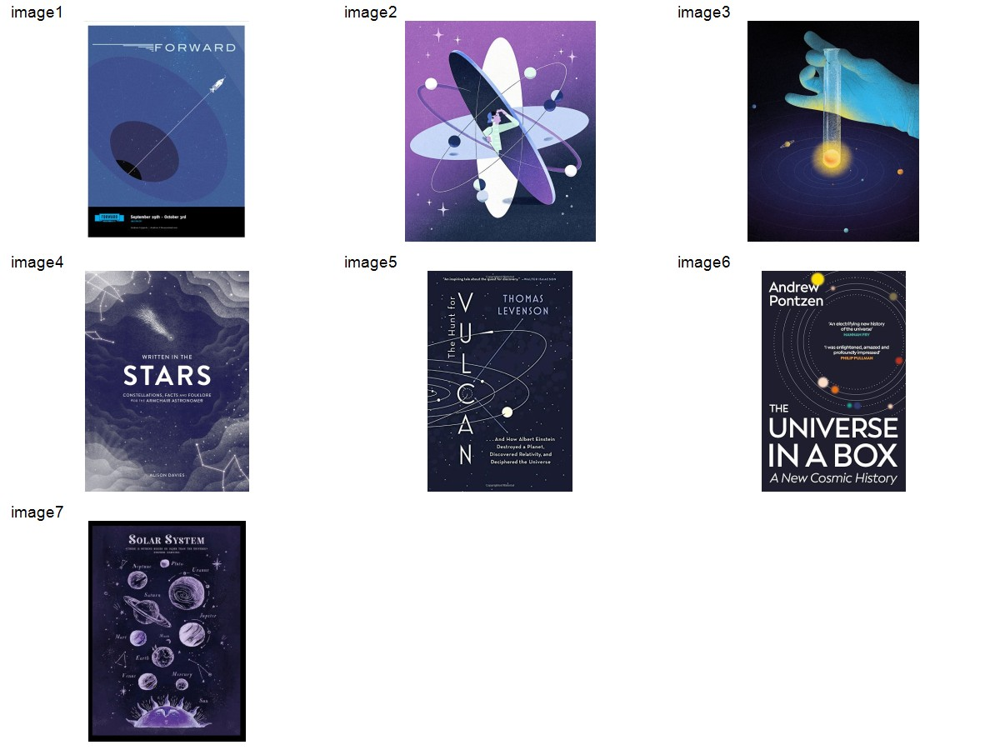
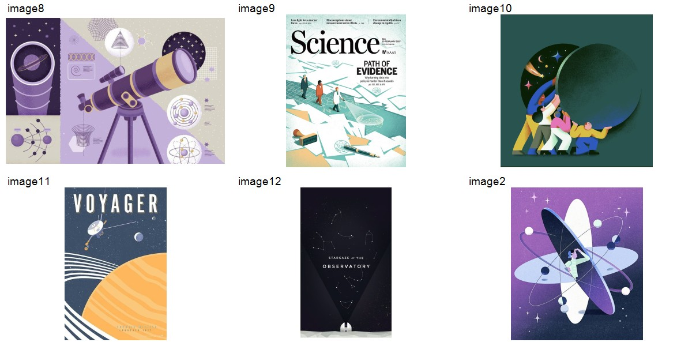
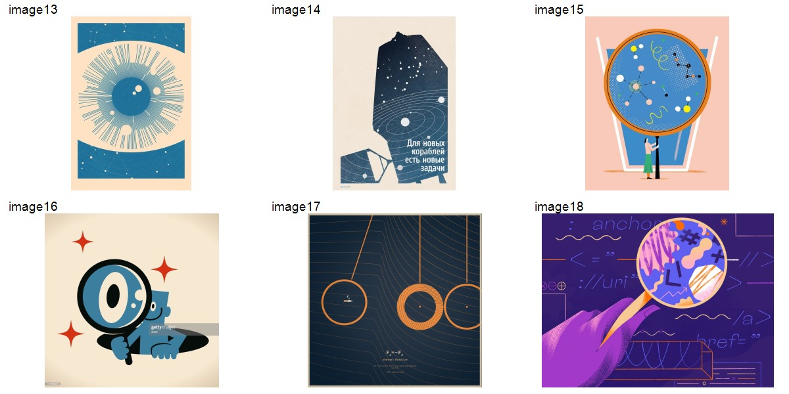
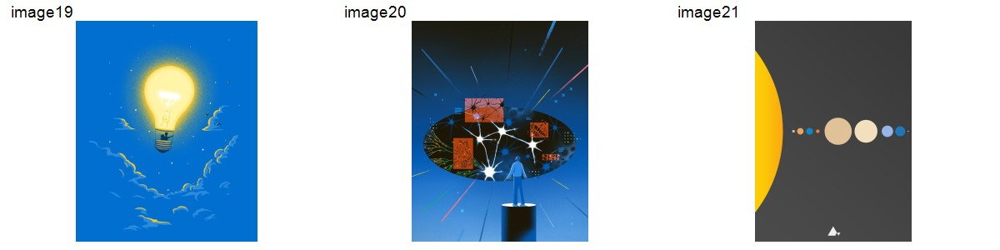
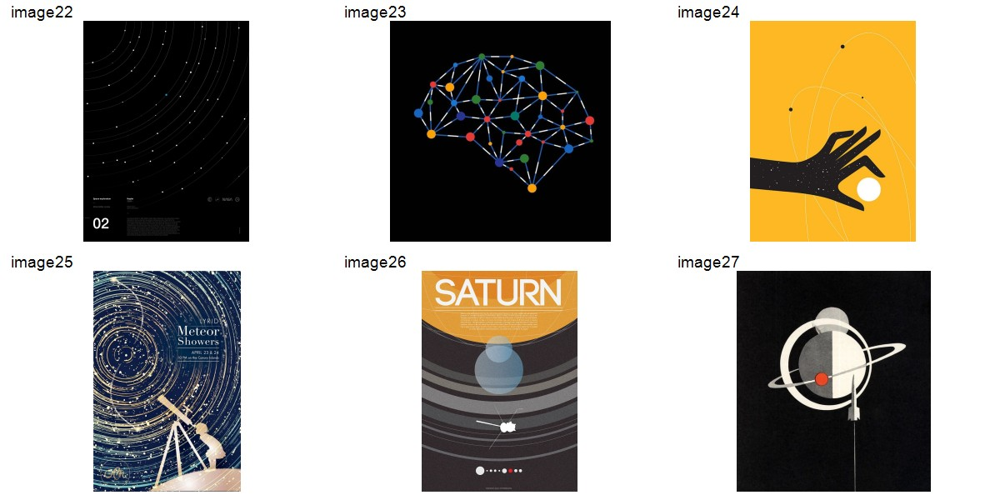
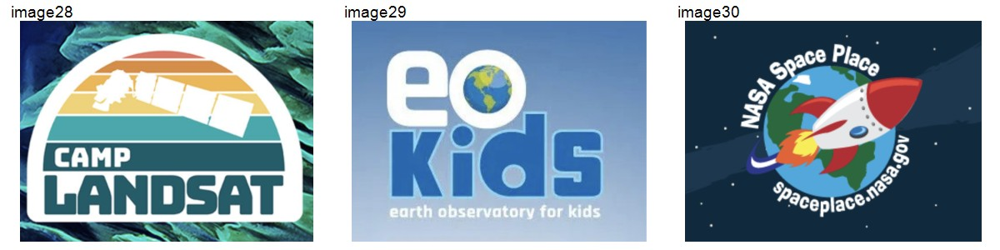

# 画风参考

参考图片统一收录在 `references/`，按整体氛围、颜色、造型、构图创意和科学元素组织。以下是视觉分析，不将图中文字、天文数据或构图比例直接作为实验功能需求。

共同原则：所有页面的画面元素遵循统一科普插画风格，每个实验可以有自己的主色调。两张深蓝天文图片继续作为空间、质感和牛顿实验配色的参考，不再承担全站配色约束。

## 参考一：太阳系与望远镜观测插画

- 主要借鉴：深蓝底、细纸面颗粒、简化几何形体、柔和浅立体明暗；大面积冷色与局部太阳暖黄、珊瑚色、薄荷色形成对照。
- 线条与空间：细而浅的椭圆轨道、稀疏星点、大面积留白；主体可以完整辨识，装饰不争夺注意力。
- 情绪：亲切、安静的共同探索，适合教学场景。
- 应用边界：借鉴纹理、形体和冷暖关系；人物、太阳系排布、横幅比例并非当前页面必须复刻的内容。颗粒不可覆盖 UI 文本或玻璃正面。

## 参考二：TRAPPIST-1 天文信息海报

- 主要借鉴：深靛蓝星空、蓝紫山体的前后层次、细轨道与局部柔光、低饱和天体及少量暖色强调。
- 信息组织：标题、注释、主体图和底部比较区分工清楚；细线网格帮助组织信息，主体仍占主要视觉面积。
- 排版气质：展示性衬线标题与简洁说明形成层级，可作为科普内容展示的参考。
- 应用边界：竖版海报不直接替代 16:9 交互舞台；不照搬大标题框、密集注释、行星数据或较低对比的小字。海报衬线字体不覆盖现有共享黑体标题规则。

## 颜色参考

原图：[1](references/ref-03.jpeg)、[2](references/ref-04.jpeg)、[3](references/ref-05.jpeg)、[4](references/ref-06.jpeg)、[5](references/ref-07.jpeg)、[6](references/ref-08.jpeg)、[7](references/ref-09.jpeg)。

主要为蓝、靛紫和深色空间，配合明亮局部主体、细线、少量暖色或浅色强调。借鉴背景与主体的明度层级和冷暖关系；不据此要求全部实验使用深蓝。

## 造型与质感参考

原图：[8](references/ref-10.jpeg)、[9](references/ref-11.jpeg)、[10](references/ref-12.jpeg)、[11](references/ref-13.jpeg)、[12](references/ref-14.jpeg)、[2](references/ref-04.jpeg)。

涵盖望远镜、人物、科学探索、行星与天文台。可提炼的共同方向是几何概括的轮廓、完整可识别的物件、大色块、有限的明暗层次和适量颗粒；其中既有偏平面的海报插画，也有浅立体、叠层纸感的表现。

这些图也包含浅底紫色、青绿、深绿、蓝配暖黄等组合，为主题色变化提供依据。全站应在这个画风范围内保持稳定的细节密度，而不是让每个实验切换成另一种画法。

## 构图与科学意象

原图：[13](references/ref-15.jpeg)、[14](references/ref-16.jpeg)、[15](references/ref-17.jpeg)、[16](references/ref-18.jpeg)、[17](references/ref-19.jpeg)、[18](references/ref-20.jpeg)。

借鉴观察窗口、尺度对照、人物与宇宙、轨迹和科学图形的构图手法。图中的头像剪影、放大镜、手掌等是创意示例，不是每页固定装饰；只在帮助表达实验主题时采用。概念插画里的夸张不能替代实验区域的正确几何关系。

### 视觉中心与尺度

原图：[19](references/ref-21.jpeg)、[20](references/ref-22.jpeg)、[21](references/ref-23.jpeg)。

借鉴局部发光主体、探索者与观察空间、极简天体尺度序列。画面可以有鲜明视觉中心，也可以通过留白和简洁排列表达科学关系；交互实验仍应把操作对象和观测结果放在主要位置。

## 科学图形与元素

原图：[22](references/ref-24.jpeg)、[23](references/ref-25.jpeg)、[24](references/ref-26.jpeg)、[25](references/ref-27.jpeg)、[26](references/ref-28.jpeg)、[27](references/ref-29.jpeg)。

借鉴细轨道弧线、点线连接、星点、望远镜剪影、圆形天体及轨道环。线条与点的密度应服从当前实验的信息量；参考中的密集星轨适合局部主题画面，不直接铺到读数、控件或测量区域。

### 教育图形与物件简化

原图：[28](references/ref-30.png)、[29](references/ref-31.png)、[30](references/ref-32.png)。

包含卫星、地球和火箭的教育品牌图形，可借鉴对象的简化方式、清晰轮廓与友好的识别感。图片中的 NASA 等标志、品牌名称和网站文字仅作为原参考的一部分保存，不作为本项目标识或直接使用素材。

## 综合使用

采用参考一的颗粒与友好形体，结合参考二的信息秩序，结合不同底色、造型和科学元素扩展到全站。深空层次适用于需要星空的实验；城市、月面、实验台或地球测量场景各自组织背景与主色。设备、光路与控件仍以当前实验任务为中心。牛顿第一阶段保持光学网格场景。

图片作者、原始发布地址与授权范围尚未提供。本目录记录用户所给参考，不将其登记为已获授权的产品背景资源。
