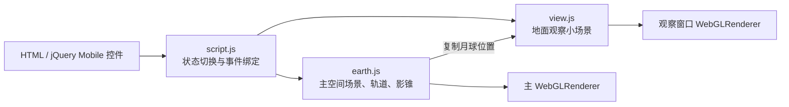
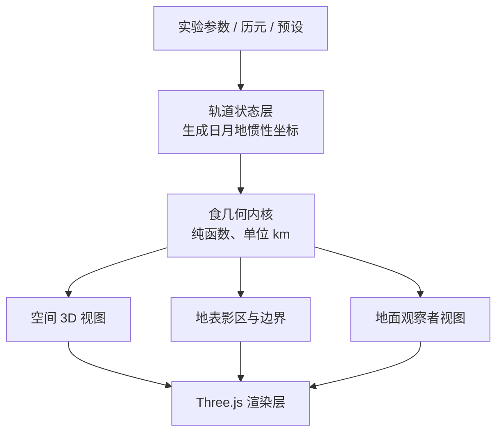

# EarthSpaceLab 日月食模拟逆向分析报告

> 分析对象：[EarthSpaceLab — 日食和月食](https://www.earthspacelab.com/app/eclipse/zh)  
> 检查日期：2026-08-06  
> 分析范围：无需登录即可访问的页面、客户端脚本、样式、纹理资源和运行时表现  
> 本文不涉及服务端实现，也不复制原站大段代码。

## 1. 结论摘要

EarthSpaceLab 的日月食页面是一个以教学演示为目标的传统 Three.js 应用。它采用两个相互独立的 WebGL 场景：主场景表现日—月—地空间关系和影锥，小场景表现“从地球上看”的太阳或月球盘面。【源码确认】【运行时确认】

它的核心思路可以概括为：

1. 用一个角参数推动月球沿近似倾斜圆轨道运动；
2. 用相似三角形求本影锥尖端距离；
3. 用 `ConeGeometry` 将本影和代表光线范围的圆锥直接画出来；
4. 根据月球位于地球朝日侧还是背日侧，切换日食与月食展示；
5. 在第二个场景中复制月球位置，并使用固定相机、固定视场角和黑色遮罩圆模拟地面观感。【源码确认】

原站实现清楚直观、适合解释“为什么不是每个月都有食”，但并不是天文预报器。页面本身明确声明：不显示半影、忽略地球公转和绕质心运动、默认距离与天体尺寸不按实际比例。【运行时确认】

最关键的技术判断是：原站标注为“从地球上看（正午的赤道）”的窗口并没有把相机严格放置在地球赤道表面，也没有从地表观察点重新计算日月视线；它是一个专门构造的第二场景，通过固定相机和人工调节的 FOV 获得近似盘面效果。【源码确认】【推断】

---

## 2. 证据标记说明

- **【源码确认】**：可以直接从公开客户端脚本或页面结构确认。
- **【运行时确认】**：通过浏览器实际运行、切换控件或检查渲染节点确认。
- **【推断】**：根据代码结构和画面行为作出的工程判断；不是作者的公开说明。

主要公开来源：

- [页面入口](https://www.earthspacelab.com/app/eclipse/zh)
- [`earth.js`](https://www.earthspacelab.com/app/eclipse/earth.js?version=2025-01-09)
- [`view.js`](https://www.earthspacelab.com/app/eclipse/view.js?version=2025-01-09)
- [`script.js`](https://www.earthspacelab.com/app/eclipse/script.js?version=2025-01-09)
- [`style.css`](https://www.earthspacelab.com/app/eclipse/style.css)
- [站点自带 `three.min.js`](https://www.earthspacelab.com/app/js/three.min.js)

---

## 3. 技术栈与模块关系

### 3.1 技术栈

| 组成 | 观察结果 | 证据 |
|---|---|---|
| 3D 引擎 | Three.js r84，使用全局 `THREE` | 【源码确认】 |
| 相机控制 | 旧版 `OrbitControls.js`，仅主场景启用 | 【源码确认】 |
| UI | jQuery 1.11.3 + jQuery Mobile 1.4.5 | 【源码确认】 |
| 渲染 | 两个 `WebGLRenderer`、两个 `<canvas>` | 【源码确认】【运行时确认】 |
| 模型 | `SphereGeometry`、`ConeGeometry`、`CircleGeometry`、`PlaneGeometry` 等程序几何 | 【源码确认】 |
| 纹理 | `earth-day.webp`、`moon.webp`、`starfield_light.webp` | 【源码确认】【运行时确认】 |
| 动画 | `requestAnimationFrame` + `THREE.Clock` | 【源码确认】 |

页面没有加载 FBX、OBJ 或 glTF 模型。地球、月球、太阳、影锥和轨道全部由 Three.js 基础几何构造。【源码确认】

### 3.2 模块职责



- `earth.js` 定义一个 `earth` 构造函数，持有主场景全部对象、轨道状态、更新函数和影锥计算函数。【源码确认】
- `view.js` 定义第二个场景，用来渲染太阳/月球视盘与月食遮罩。【源码确认】
- `script.js` 创建两个实例，启动动画循环，并将复选框和滑块事件写入对象状态。【源码确认】
- `main.js.php` 主要负责侧栏展开、语言跳转和通用窗口布局，不参与食的几何计算。【源码确认】

运行时页面存在两个画布：一个约 250×250 像素的观察窗口和一个占据主区域的空间场景。【运行时确认】

---

## 4. 主场景的尺度与对象构造

### 4.1 默认展示尺度

原站默认使用的是教学展示单位，而非千米：

| 对象 | 默认半径 | 默认中心距离/位置 | 说明 |
|---|---:|---:|---|
| 太阳 | 26 | (z=250) | 发光黄球 |
| 地球 | 20 | 原点 | 贴地球纹理 |
| 月球 | 10 | 轨道半径 100 | 贴月球纹理 |

【源码确认】

这些比例大幅放大了地球和月球，使课堂画面中可以同时看清三个天体。页面底部也明确提示未按真实比例显示。【运行时确认】

### 4.2 光照与背景

- 太阳本身使用不受光照影响的黄色 `MeshBasicMaterial`。【源码确认】
- 太阳位置放置一个 `PointLight`，用来照亮地球和月球的 `MeshPhongMaterial`。【源码确认】
- 场景外层使用半径 500 的球体，内表面贴 `starfield_light.webp`，形成星空背景。【源码确认】
- 地球初始绕 Z 轴倾斜约 (23.5^circ)，模拟地轴倾角；启用地球自转后只旋转地球纹理球。【源码确认】

---

## 5. 月球轨道、月相位置和交点进动

### 5.1 月球位置参数

主状态变量 `moonposition` 是月球沿轨道的相位角。页面滑块把 (0^circsim360^circ) 映射到该角度，并减去 (90^circ) 作为内部相位零点。【源码确认】

代码先计算月球相对黄道的近似纬度：

\[
\theta=i\sin\left(\phi+\Omega-\frac{\pi}{2}\right)
\]

然后构造月球位置：

\[
\begin{aligned}
x &= r\sin\phi\cos\theta \\
y &= r\sin\theta \\
z &= r\cos\phi\cos\theta
\end{aligned}
\]

其中：

- (r) 是月球轨道展示半径；
- (phi) 是月球相位角；
- (i) 对应 `moon_angle`，默认 (5^circ)；
- (Omega) 对应 `moon_angleZ`，默认 (90^circ)。【源码确认】

这个模型会产生接近正弦变化的黄纬，足以展示月球多数时候从日地连线上方或下方经过。【推断】

它不是将一个圆轨道通过严格的三维旋转矩阵倾斜 (i) 后所得的开普勒轨道；尤其在倾角被滑块提高到 (20^circ) 时，与严格旋转圆轨道的差异会更明显。【源码确认】【推断】

### 5.2 轨道倾角与节点方向

- `moonangle` 滑块范围为 (-20^circsim20^circ)，默认 (5^circ)；页面用它说明月球轨道相对黄道的倾角。【运行时确认】
- `moonangleZ` 滑块范围为 (0^circsim360^circ)，会旋转轨道线并改变月球黄纬的相位。【源码确认】【运行时确认】
- 页面把第二个滑块标为“沙罗周期的历程（约 18 年）”，本质上是手动扫描交点方向，并没有按照日期积分 18.6 年节点退行。【源码确认】【推断】

原站默认采用 (5^circ)，而更精确的月球轨道对黄道平均倾角约为 (5.145^circ)。其教学结论正确，但常数经过了取整。【源码确认】

### 5.3 动画速度

启用月球运动后，相位按下式递增：

\[
\dot\phi=\frac{90^circ}{29.5\ \mathrm{s}}
\]

因此一个完整月相周期约在 118 秒内播放完。它不是实时天文速度，而是把约 29.5 天的朔望月压缩为课堂可观察的动画。【源码确认】【推断】

启用地球自转时，地球按约 (90^circ/\mathrm{s}) 旋转，同样属于教学加速。【源码确认】

---

## 6. 日食与月食的状态切换

原站没有执行完整的日月视圆相交分类。它首先依据月球相位所在的半周判断当前展示日食还是月食：

- 月球位于地球背日侧的半周时，隐藏月球影锥、显示地球影锥，并把小窗口标题切换为月食；
- 月球位于地球朝日侧的半周时，显示月球影锥、隐藏地球影锥，并把小窗口标题切换为日食。【源码确认】

轨道倾角造成的 Y 方向偏移决定月球或影锥是否实际穿过目标天体，因此用户拖动月球位置和节点方向时可以观察“接近交点才发生食”的现象。【源码确认】【运行时确认】

但代码没有输出严格的“无食、偏食、全食、环食”离散分类，也没有计算食分、接触时刻或地表食带。【源码确认】

---

## 7. 影锥算法

### 7.1 本影锥长度

原站函数 `getShadow1Length` 接收太阳半径 (R_s)、遮挡天体半径 (R_o) 和两者中心距离 (D)，返回：

\[
L_{s\rightarrow apex}
=D+\frac{D R_o}{R_s-R_o}
=\frac{D R_s}{R_s-R_o}
\]

这是从太阳中心量到本影尖端的距离。遮挡天体中心到本影尖端的长度则为：

\[
L_u=L_{s\rightarrow apex}-D
=\frac{D R_o}{R_s-R_o}
\]

公式来自太阳和遮挡天体外公切线形成的相似三角形。【源码确认】

### 7.2 月球本影

月球位置变化后，程序执行以下步骤：

1. 求太阳到月球的单位方向向量；
2. 求当前日月中心距离；
3. 根据相似三角形重新计算锥长；
4. 释放旧圆锥几何；
5. 创建新的 `ConeGeometry`；
6. 把圆锥移动到太阳—月球轴线上，并通过 `lookAt` 对准该轴。【源码确认】

非真实比例模式会在月球半径上额外增加约 0.5 个展示单位，真实比例模式增加约 0.1 个单位，使影锥在画面中更容易触及地球并被观察到。【源码确认】【推断】

### 7.3 地球本影

地球本影采用同一公式，以地球作为遮挡天体，构造背向太阳延伸的黑色圆锥；另有一个从太阳延伸到影锥尖端的低透明黄色圆锥，用来表现限制光线。【源码确认】

### 7.4 原站没有计算的部分

- 不构造半影外公切锥；页面明确写出“未显示半影”。【源码确认】【运行时确认】
- 没有反本影/环食区的独立几何与判定。【源码确认】
- 没有求影锥与地球球面的精确交线。【源码确认】
- 没有将影区投影成地理经纬度范围。【源码确认】
- 没有考虑地球椭球、月缘地形、大气折射、光行时或天体历表。【源码确认】

因此，原站中的圆锥主要是解释光路关系的视觉对象，而不是精密食带计算结果。【推断】

---

## 8. “从地球上看”观察窗口的实现

### 8.1 独立场景而非主场景相机

`view.js` 新建了独立的 `Scene`、`WebGLRenderer`、太阳球和月球球。每帧只把主场景月球的 XYZ 坐标复制给观察场景月球。【源码确认】

观察场景没有地球球体，也没有由经纬度生成的地表观察点。【源码确认】

### 8.2 三套固定相机

| 相机 | 位置 | 垂直 FOV | 用途 |
|---|---:|---:|---|
| 默认相机 | ((0,0,5)) | (30^circ) | 夸张比例模式 |
| 远距日食相机 | ((0,0,57)) | (3.3^circ) | “真实比例”日食 |
| 远距月食相机 | ((0,0,-57)) | (5.8^circ) | “真实比例”月食 |

【源码确认】

日食半周时，相机朝 (+Z) 方向看；月食半周时，相机朝 (-Z) 方向看。真实比例复选框只决定渲染时选用默认相机还是两台远距相机。【源码确认】

这些相机位置和 FOV 是人为调节的展示参数，不是由地球半径、观察者经纬度、日月距离和相机传感器模型统一推导出来的。【源码确认】【推断】

### 8.3 月食遮罩

观察场景额外创建两个半透明黑色圆盘：

- 默认比例圆盘半径约 5，位于 (z=-25)；
- 真实比例圆盘半径约 0.7，位于 (z=-80)。【源码确认】

切换真实比例时，两者的可见性互换。结合相机朝向与画面表现，这些圆盘用于在月球盘面前模拟地球本影，而不是渲染真实三维地球影锥与月球球面的交叠。【源码确认】【推断】

### 8.4 “正午赤道”标签应如何理解

原站 UI 将该窗口标注为“从地球上看（午夜的赤道）”或中文页面当前显示的“从地球上看（午夜的赤道）/正午的赤道”语义标签。【运行时确认】

从实现上看，它更准确的定义是：以接近地心的固定轴向相机观察太阳或月球方向的示意窗口。它没有：

- 构造赤道地表点 \(\mathbf P\)；
- 计算地表法线与地方天顶；
- 根据太阳时确定观察者经度；
- 求观察点到日月中心的单位视线；
- 处理地面视差和地平线。【源码确认】

所以该窗口能够表现日月盘面错开和月食遮挡，但不能被视为严格的地面天球坐标模拟。【推断】

---

## 9. “按实际比例”模式

### 9.1 地球和月球缩放

程序把月地平均距离 384,000 km 映射为 100 个展示单位：

\[
k=\frac{100}{384000}
\]

因此：

\[
R_m=1738k\approx0.4526
\]

\[
R_e=6371k\approx1.6591
\]

这部分保持了地月尺寸与月地距离之间的一致比例。【源码确认】

### 9.2 太阳缩放与人工修正

太阳位置被移动到 450 个展示单位，半径按以下方式计算：

\[
R_s=\frac{696000}{149600000}\times450\times0.98
\approx2.052
\]

代码注释明确说明，额外乘以 `0.98` 是为了“稍微缩小，使阴影接触地球”。【源码确认】

这意味着“真实比例”仍不是纯粹由真实参数决定，而是为了在有限画面和简化几何下保证可见效果进行了约 2% 的校正。【源码确认】【推断】

### 9.3 几何重建

切换比例时，程序会：

1. 修改四个天体展示半径；
2. 释放地球、月球、太阳的旧几何；
3. 重新创建 `SphereGeometry`；
4. 切换月食遮罩圆；
5. 重新执行月球影锥和地球影锥更新；
6. 显示或隐藏指向微小月球的红色箭头。【源码确认】

### 9.4 潜在同步问题

比例切换把主场景太阳 Mesh 移动到 (z=450)，但没有同步更新保存默认距离的 `sun_position` 字段；地球影锥更新仍有部分计算使用旧值 250。【源码确认】

同时，观察小场景太阳的几何半径会更新，但其位置没有随主场景太阳一起移动到 450。【源码确认】

这会造成主场景太阳位置、地球影锥计算距离和观察场景太阳位置之间存在两个距离尺度。是否属于有意的视觉调校无法从公开代码确认，但从工程一致性看应视为潜在缺陷。【推断】

---

## 10. 渲染循环与交互数据流

动画循环每帧依次执行：

```text
requestAnimationFrame
  → 渲染主场景
  → 更新主场景状态
  → 渲染观察场景
  → 更新观察场景月球位置与相机方向
  → 更新日食/月食标题和图例
```

【源码确认】

更新发生在对应渲染之后，因此画面理论上显示的是上一帧状态，延迟约一帧，实际肉眼通常不可察觉。【源码确认】【推断】

控件直接修改 `earth` 和 `view` 对象的公开字段，没有独立状态仓库或纯计算层。滑块事件会立即触发月球位置、轨道线或影锥更新。【源码确认】

主要交互映射：

| 控件 | 内部作用 | 证据 |
|---|---|---|
| 月球绕地球运动 | 切换 `anim_moon` | 【源码确认】 |
| 地球自转 | 切换 `anim_axis` | 【源码确认】 |
| 按实际比例 | 改半径、相机、遮罩和太阳位置 | 【源码确认】 |
| 从地球上看 | 显示/隐藏第二画布 | 【源码确认】【运行时确认】 |
| 显示黄道面 | 切换紫色平面和日地轴线 | 【源码确认】 |
| 月球位置 | 设置轨道相位 (0^circ\sim360^circ) | 【源码确认】【运行时确认】 |
| 沙罗周期进程 | 设置交点方向 (0^circ\sim360^circ) | 【源码确认】【运行时确认】 |

---

## 11. 原站方案评价

### 11.1 优点

- 用很少的代码把日食、月食、轨道倾角和交点关系放在同一交互场景中，教学目标明确。【源码确认】【推断】
- `ConeGeometry` 与星体位置同步，用户可以直接看到影锥是否碰到地球或月球。【源码确认】【运行时确认】
- 默认夸张比例保证太阳、地球、月球都可辨认，真实比例开关则帮助用户理解天体尺度差异。【运行时确认】【推断】
- 双场景结构把“空间机制”和“地面观感”并排呈现，认知路径简洁。【运行时确认】【推断】
- 页面和核心脚本体量较小，对低性能设备友好。【源码确认】【推断】

### 11.2 科学精度局限

- 月球轨道用正弦纬度近似，不是完整的轨道平面旋转或开普勒轨道。【源码确认】
- 轨道倾角取整为 (5^circ)，节点进动由手动角度代替历元模型。【源码确认】
- 默认尺寸、距离和影锥底面存在人为放大。【源码确认】
- “真实比例”对太阳半径乘以 `0.98`，并存在距离状态可能不同步的问题。【源码确认】
- 只画本影和限制光线，不计算半影、反本影及地表投影。【源码确认】
- 地面观察窗口不是地表观察者模型，不包含地面视差、地平坐标或地方太阳时。【源码确认】
- 没有真实历表、轨道偏心率、地球公转、地月质心运动、月球黄纬摄动和月缘地形。【源码确认】

### 11.3 工程债务

- Three.js r84、jQuery 1.x 和 jQuery Mobile 1.4.5 均属于旧式技术栈。【源码确认】
- 状态、计算、DOM 操作和渲染强耦合，不易单元测试。【源码确认】【推断】
- 滑块变化时频繁释放并重建球体和圆锥几何，可以改为变换或复用 BufferGeometry。【源码确认】【推断】
- 使用两个持续渲染的 WebGLRenderer，会增加显存和帧渲染开销。【源码确认】【推断】
- 若多次切换尺寸或重建子对象，材质与嵌套几何的资源生命周期不够集中。【推断】
- 物理常数、展示尺度和人工补偿混在同一对象字段中，容易产生同步错误。【源码确认】【推断】

---

## 12. 与当前本地模拟器的对比

当前本地实现指 `solar-eclipse-3d.html`、`solar-eclipse-3d.js` 与 `solar-eclipse-3d.css`。

| 项目 | EarthSpaceLab 原站 | 当前本地页面 | 推荐方向 |
|---|---|---|---|
| Three.js | r84，全局脚本 | 0.160.0，全局脚本 | 改为现代 ES Module，并锁定本地依赖 |
| 状态模型 | 对象字段和 DOM 事件直接耦合 | 单一 `state` 驱动多个视图 | 继续拆分为纯数据状态与渲染状态 |
| 基础单位 | 默认展示单位，真实模式临时换算 | 几何内核统一使用 km | 保持 km，显示缩放不回写物理状态 |
| 月球位置 | 圆轨道相位 + 正弦黄纬 | 月地距离 + 东西/南北偏移 | 增加真实倾斜轨道与节点进动参数层 |
| 本影 | 相似三角形圆锥 | 公切锥角与锥顶长度 | 保留当前实现并增加解析交线测试 |
| 半影 | 不显示 | 已构造并绘制 | 保留 |
| 反本影 | 无独立实现 | 已构造并判定环食 | 保留 |
| 地表范围 | 无 | 视圆相交逐点分类，960×480 网格 | 增加自适应边界求解，提高窄食带精度 |
| 最大遮挡点 | 无 | 全球粗搜 + 局部细化 | 改为球面优化并输出误差界限 |
| 地面观察 | 独立场景 + 固定相机/FOV | 赤道正午地表点 + 真实角尺度 | 保留，并支持任意经纬度与时刻 |
| 全景 | 比例夸张但提示 | 明确标注距离压缩 | 保留标签，避免用户误解 |
| 自检 | 未发现自动化自检 | 内置全食/环食几何自检 | 扩充为独立测试套件 |

【源码确认】【运行时确认】

当前本地页面已经比原站更严谨地完成以下能力：

- `computeGeometry` 使用真实半径和矢量位置求日月距离、影轴偏移、锥角和锥顶距离；【源码确认】
- `evaluateNormal` 从地表点分别求日月视角半径和视中心角距，区分无食、偏食、全食和环食；【源码确认】
- `renderFootprint` 将分类结果投影到经纬度地图；【源码确认】
- `buildExactCones` 分别构造半影、本影和反本影；【源码确认】
- `buildSkyView` 从赤道地方正午地表点计算太阳、月球高度角、方位角、视直径和遮挡率。【源码确认】

当前本地页面仍缺少“由月球真实轨道自然产生位置”的上游层。现有东西/南北偏移适合实验控制，但不能直接表达月相、交点和 18.6 年进动之间的关系。【源码确认】【推断】

---

## 13. 推荐重构蓝图

### 13.1 总体架构



原则：轨道状态、食几何、显示缩放和 Three.js 对象必须分层。渲染层只能读取计算结果，不能修改公里制物理状态。【推荐方案】

### 13.2 建议的数据接口

```ts
type Vec3Km = { x: number; y: number; z: number };

interface BodyState {
  centerKm: Vec3Km;
  radiusKm: number;
}

interface OrbitalInputs {
  epoch?: string;
  moonPhaseRad: number;
  lunarInclinationRad: number;   // 默认 5.145°
  ascendingNodeRad: number;
  earthMoonDistanceKm: number;
  earthSunDistanceKm: number;
}

interface ObserverState {
  latitudeRad: number;
  longitudeRad: number;
  elevationKm: number;
}

interface EclipseSolution {
  shadowAxis: Vec3Km;
  axisOffsetKm: number;
  umbraApexKm: Vec3Km;
  umbraRadiusAtEarthKm: number;
  penumbraRadiusAtEarthKm: number;
  globalType: "none" | "partial" | "total" | "annular";
}
```

【推荐方案】

这些接口只表达计算输入输出，不暴露 Three.js 的 `Vector3`、Mesh 或材质，便于 Node 环境单元测试和未来替换渲染器。【推荐方案】

### 13.3 月球轨道模型

教学模式可先使用圆轨道，但必须用严格的旋转矩阵：

1. 在月球轨道局部坐标中构造

\[
\mathbf r_0=
\begin{bmatrix}
r\cos f \\
r\sin f \\
0
\end{bmatrix}
\]

2. 依次应用倾角 (i=5.145^circ) 和升交点经度 (Omega)：

\[
\mathbf r=R_z(\Omega)R_x(i)\mathbf r_0
\]

3. 若启用进动动画，用约 18.6 年周期更新节点：

\[
\Omega(t)=\Omega_0-\frac{2\pi}{18.6\ \mathrm{yr}}(t-t_0)
\]

负号代表月球交点总体退行。该模型比原站的正弦黄纬写法更清晰，也能保证轨道始终严格位于一个平面内。【推荐方案】

进一步的高精度模式应从 JPL/天文历表读取日月地中心位置，而不是继续扩展简化开普勒参数。【推荐方案】

### 13.4 影锥与地表分类

继续采用当前本地实现中的公切锥几何：

\[
\alpha_u=\arcsin\frac{R_s-R_m}{D_{sm}},\qquad
L_u=\frac{R_m}{\sin\alpha_u}
\]

\[
\alpha_p=\arcsin\frac{R_s+R_m}{D_{sm}}
\]

对地表点 \(\mathbf P\) 计算：

\[
\alpha_s=\arcsin\frac{R_s}{|\mathbf S-\mathbf P|},\qquad
\alpha_m=\arcsin\frac{R_m}{|\mathbf M-\mathbf P|}
\]

\[
\delta=\arccos
\frac{(\mathbf S-\mathbf P)\cdot(\mathbf M-\mathbf P)}
{|\mathbf S-\mathbf P||\mathbf M-\mathbf P|}
\]

分类规则：

- \(\delta>\alpha_s+\alpha_m\)：无食；
- \(|\alpha_m-\alpha_s|<\delta\le\alpha_s+\alpha_m\)：偏食；
- \(\alpha_m\ge\alpha_s\) 且 \(\delta\le\alpha_m-\alpha_s\)：全食；
- \(\alpha_s>\alpha_m\) 且 \(\delta\le\alpha_s-\alpha_m\)：环食。【推荐方案】

地表边界不要长期依赖固定 960×480 栅格。建议先用粗网格定位，再在相邻异类单元内用球面二分或 marching squares 求边界，使窄本影带不受约 (0.375^circ) 像素分辨率限制。【推荐方案】

### 13.5 严格地面观察视角

赤道地方太阳正午观察点定义为：

\[
\varphi=0,qquad \lambda=\lambda_{subsolar}
\]

球形地球下：

\[
\mathbf P=\mathbf E+R_e
\begin{bmatrix}
\cos\lambda\\
0\\
\sin\lambda
\end{bmatrix}
\]

相机视线必须从 \(\mathbf P\) 分别指向太阳和月球：

\[
\hat{\mathbf d}_s=\frac{\mathbf S-\mathbf P}{|\mathbf S-\mathbf P|},\qquad
\hat{\mathbf d}_m=\frac{\mathbf M-\mathbf P}{|\mathbf M-\mathbf P|}
\]

渲染时可以把太阳和月球放到任意标准化深度，但球面半径必须满足：

\[
r_{render}=d_{render}\tan\alpha
\]

这样既避免把相机放在相差一亿千米的真实场景中造成深度精度问题，又能严格保留视直径和盘面角距。当前本地 `buildSkyView` 已采用这一思路。【源码确认】【推荐方案】

后续应增加任意观察者经纬度、海拔和 UTC 时刻，并用地方东—北—天坐标输出高度角、方位角和地平线状态。【推荐方案】

### 13.6 渲染层

- 使用现代 Three.js ES Module，锁定版本并尽量本地化依赖，避免 CDN 或旧 UMD 构建警告。【推荐方案】
- 保留一台 `WebGLRenderer`，通过相机切换或 viewport/scissor 渲染多个视图；只有确有隔离需求时才启用第二渲染器。【推荐方案】
- 影锥 Mesh 只更新变换和顶点缓冲，避免每个滑块事件重建全部材质与球体。【推荐方案】
- 真实比例、地月视图和全景示意必须继续显示尺度标签；压缩距离仅影响展示坐标。【推荐方案】
- 地面天空背景、日冕和月球纹理属于视觉层，不能反向影响视角或食型计算。【推荐方案】

---

## 14. 建议测试与验收标准

### 14.1 几何单元测试

1. 日月地完全共线、近地点月球：地表中心点应分类为全食。
2. 日月地完全共线、远地点月球：中心点应分类为环食。
3. 横向偏移大于地球半径与半影半径之和：全球无食。
4. 影轴仅与地球边缘相交：只出现偏食区域。
5. 交换任意世界坐标轴或整体旋转系统：食型和覆盖面积保持不变。
6. 月轨倾角为零且新月位置对齐：每个朔望周期出现中心食。
7. 月轨倾角为 (5.145^circ)：只有接近升交点或降交点的新月产生食。
8. 节点角前进一周后：几何状态回到起点；18.6 年动画方向为退行。

### 14.2 观察者测试

1. 太阳直射纬度为 (0^circ)、影轴穿过地心：赤道正午观察者看到中心全食或环食。
2. 太阳直射纬度为 (15^circ)、中心影轴通过直射点：赤道观察者因地面视差不应自动继承全球最大食型。
3. 观察点位于夜半球：即使日月视线方向接近，也必须返回不可见。
4. 太阳和月球视圆刚好外切时，遮挡率趋近 0；内切时正确进入全食或环食。
5. 视觉盘面像素直径比应与计算得到的角直径比一致，误差控制在一个像素以内。

### 14.3 地图与性能测试

- 对食带边界进行分辨率加倍测试；边界位置和面积应收敛。
- 连续拖动滑块时，几何计算可延迟合并，但 3D 主场景响应应保持流畅。
- 检查 Three.js 几何、材质和纹理在视图切换后是否释放，避免显存持续增长。
- 在窄屏、普通桌面和高 DPI 屏幕验证画布比例、控制区滚动和标签遮挡。

### 14.4 对外验收标准

- 计算内核始终使用 km 和弧度；显示层负责单位格式化。
- 所有“示意比例”画面都有明确标签。
- 全局食型、地表最大食分与指定观察者所见食型分别展示，不能混用。
- 半影、本影和反本影均可单独显示并有一致图例。
- 任意地表观察点的结果可由同一个视圆分类函数复算。
- 轨道倾角和节点进动改变月球位置，而不是直接硬编码食型。

---

## 15. 最终判断

EarthSpaceLab 的价值主要在教学叙事而非数值精度：它通过夸张比例、简单轨道、直观影锥和独立观察窗口，在很小的实现规模内解释了轨道倾角与日月食的关系。【源码确认】【运行时确认】【推断】

不建议原样复制其固定相机、遮罩圆、2% 太阳半径修正和状态耦合结构。值得继承的是“双视角同时解释空间机制与地面现象”的产品思路，以及通过节点方向展示食季循环的交互设计。【推断】

当前本地模拟器已经具备更严谨的影锥、地表分类和正午赤道观察模型。下一阶段最有价值的工作是补上独立轨道状态层，让 (5.145^circ) 月轨倾角、月相位置和约 18.6 年交点进动直接生成月球三维位置，再由现有几何内核自然判定是否发生日食或月食。【源码确认】【推荐方案】

