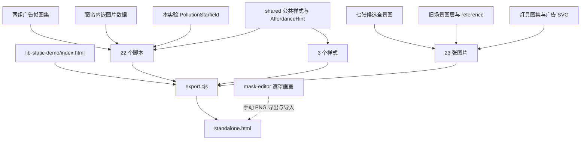

# 光污染工程依赖审计与模块解耦方案

日期：2026-10-28。分析基线：当前工作区 `lib-static-demo/standalone.html`，SHA-256 `175ad5e70c360b37be5dec91d656c9e5bb8ec4caa05fb3310c0dff164a43fe93`。分支 `experiment/light-pollution/sky-preview`，HEAD `d357477` 加当前未提交内容。本文是工程重构方案，本轮不迁移运行模块、不修改科学模型。

## 1. 结论与实际完成事项

建议把目前的候选页作为本轮行为基线，采用“纯状态与命令 → 功能服务 → 渲染 → 展示/编辑 UI”的单向依赖。运行页与完整编辑器共用功能服务，禁止用模拟点击另一个面板按钮来完成业务操作。资源以 manifest 管理，离线 HTML 仅为构建产物。

本轮完成：

1. 枚举光污染目录 1036 个文件并记录字节数和 SHA-256，包括历史资料文件；排除 node_modules、.git、__pycache__ 和本轮 audit 输出目录。该数字为生成清单时的快照，随后新增本报告等文件不包含在其中。对当前运行模块逐个检查职责、状态、初始化、资源和跨模块调用；历史快照只用于库存与引用核查，不作为新设计依据。
2. 执行现有 export.cjs 的读取流程，在内存中捕获生成结果；49 个输入文件全部有来源和哈希，生成结果与当前 standalone 字节一致。没有为审计重写页面。
3. 在本机 Chrome 验证 candidate、legacy 两个 file:// 入口均 ready，无 JS 错误；采集窗口内没有外部请求，只有各自 HTML 文件请求。这是启动级依赖验证，不覆盖所有导入资源与手势路径。
4. 安全移除一个无改动、无忽略文件且提交历史已包含在当前分支中的光污染旧预览 worktree；其余保留原因见第 3 节。
5. 输出可复跑审计脚本、完整库存、打包依赖、模块指标、worktree 差异清单和本方案。

## 2. 工程入口与资源依赖

### 2.1 必须区分的三个层次

- **当前行为基线**：`lib-static-demo/index.html` + 源码，通过 `lib-static-demo/export.cjs` 生成同目录 `standalone.html`。file:// 打开 index 会转到 standalone。
- **旧正式入口**：实验根 `index.html`，仍由根 `npm run export -- light-pollution` 导出到 dist。这个命令不会导出当前候选场景。不能因为根 smoke 通过就宣称候选所有功能都验证通过。
- **配套工具/参考**：mask-editor 是现用遮罩制作工具；sky-preview 是星空组件宿主；static-demo、layered-demo、baseline-scroll 是其他入口或历史试验。它们不属于当前 standalone 的直接运行模块，但“未打包”不等于“可删除”。

当前 49 个输入构成：22 个脚本、3 个样式、23 张 PNG/SVG、1 个 HTML 模板。export.cjs 自身是构建工具，不计入被打包输入。22 个脚本含 2 个广告图集数据脚本及窗帘数据脚本，不能把它们当作 22 个同等复杂度的业务模块。



### 2.2 必须保留的当前输入

| 资源组 | 当前路径或来源 | 用途与边界 |
| --- | --- | --- |
| 候选场景七张原图 | `assets/libtv-composite-options-20261027/panorama/` 下 01 远景、02 地面、03 树木、01 水体、02 住宅、03 公共建筑、02 广告楼 | candidates.js 运行时去白底、裁切、配准和窗口提取；保留原始尺寸与来源 |
| 旧图层与参考图 | `lib-static-demo/assets/*.png` 共 12 张 | legacy 场景、构图参考；当前导出按目录枚举全部 PNG，新增 PNG 会自动进入包，应改为显式 manifest |
| 灯具 | `assets/lamp-sprites.png` | 当前灯具渲染直接使用 |
| 广告 SVG | `assets/billboard-demo/{orbit,city,future}.svg` | 图片轮播/兼容素材，保留离线支持 |
| 广告帧序列 | `lib-static-demo/assets/music-08/atlas-data.js`、`future-03/atlas-data.js` | 两个序列播放器使用的内嵌图集，不是实时网络视频 |
| 窗帘 | `lib-static-demo/curtain-palette.js` | 内嵌纹理与样式目录；应拆元数据与二进制资源，但不能只保留小 JS 文件 |
| 星空 | `components/pollution-starfield/starfield.js` | 当前主场景与 sky-preview 共用的实验私有组件 |
| 公共依赖 | `shared/components/affordance.js`、components.css、typography.css | 只通过公开接口引用；本轮不迁移或修改 shared |

当前 standalone 32,553,592 字节，约 31.05MiB。两组广告数据脚本合计 18,686,349 字节，约占最终 HTML 57.4%；窗帘数据约 1.35MB。体积主因是图像数据，拆 JS 文件本身不会明显减小包。legacy 与 reference 共用打包也带来额外体积，但必须先保留兼容入口，再考虑独立输出 candidate/legacy 包。

### 2.3 库存分类（十进制 MB，快照值）

| 目录 | 文件数 | 总体积 | 本次打包文件数 | 处置建议 |
| --- | ---: | ---: | ---: | --- |
| assets | 306 | 152.19MB | 11 | 保留被引用资源；生成过程文件按来源归档，不盲删 |
| lib-static-demo | 106 | 114.29MB | 34 | 当前主实现，源码/工具/测试/截图/产物混放，建议分区 |
| resource-archives | 457 | 192.91MB | 0 | 非运行依赖；有历史快照与来源意义，单独归档管理 |
| mask-editor | 69 | 10.58MB | 0 | 保留配套生产工具；主场景通过 PNG 交换，不直接依赖画室 DOM |
| static-demo | 26 | 14.23MB | 0 | 历史对照入口，后续可移入实验内 archive，但本轮未删除 |
| layered-demo | 23 | 9.20MB | 0 | 历史试拼；可能承担资源制备追溯，不直接运行依赖 |
| components | 4 | 0.013MB | 1 | 继续保留私有组件边界 |
| sky-preview | 4 | 0.009MB | 0 | 保留组件独立调试入口 |
| baseline-scroll | 3 | 0.008MB | 0 | 历史基线 |
| tests | 11 | 0.045MB | 0 | 旧正式页测试，不替代候选页专项 |
| 根文件、adapters | 27 | 0.552MB | 0 | 正式入口、需求、说明与适配约定 |

打包清单还含 4 个实验目录以外的 shared 文件，因此表中打包数量之和为 45，而非 49。库存包含重复的导出 HTML、截图、历史资料；总磁盘体积不是运行内存，也不是交付体积。

## 3. Worktree 审计与清理结果

Git worktree 是完整工作副本，不是页面模块。当前模块和资源读取均来自 B: 当前仓库，启动验证没有访问任何 worktree。删除 worktree 只减少磁盘副本，不会直接提升页面 FPS。

| 工作目录 | 核实状态 | 处理 |
| --- | --- | --- |
| B:/GithubProject/Astronomical-Exps | 当前行为基线，大量未提交内容 | 保留，未 reset/clean/切分支 |
| C:/Users/Golajah/.codex/worktrees/light-pollution-head-preview/Astronomical-Exps | detached f26d3ab；无修改、未跟踪或忽略文件；f26d3ab 是当前 HEAD 祖先 | **已通过 git worktree remove 移除**，未删除提交或分支 |
| C:/Users/Golajah/.codex/worktrees/review-light-pollution/Astronomical-Exps | f26d3ab，20 条 porcelain 状态；展开修改/未跟踪文件后 725 个与当前一致、41 个不同、503 个当前缺失；另有忽略文件；关联其他聊天 | 保留：不是可证明冗余副本。差异含新广告候选、制作记录与旧实现，不能用当前 standalone 替代全部工作成果 |
| C:/Users/Golajah/.codex/worktrees/newton-restore-head-preview/Astronomical-Exps | 牛顿分支，28 条状态、209 个忽略文件，关联其他聊天 | 保留：其他实验及未提交工作 |
| C:/Users/Golajah/.codex/worktrees/newton-step2-head-preview/Astronomical-Exps | 牛顿 detached 80caf53，干净 | 保留：其他实验历史预览，当前请求不足以证明其已无用途 |

已移除副本可用 `git worktree add --detach <新的绝对目录> f26d3aba2656aaacc2c93a91b66549702372c017` 恢复。无须恢复未提交文件，因为删除前已确认不存在。没有远程分支清理、提交或推送。

review worktree 若后续退役，应先归档全部独有/不同文件及需要的忽略资料，生成哈希清单，验证可恢复，再处理该聊天的工作目录归属。当前缺失 503 文件不意味着 503 个必需资源，但足以说明它不是可直接丢弃的镜像。

## 4. 当前模块职责与耦合分析

| 模块 | 现有职责 | 主要耦合/拆分方向 |
| --- | --- | --- |
| app.js | 初始化、候选/旧场景分支、素材处理、遮挡与命中、反射、整景合成、视图、输入 | 总装配入口过重；拆 bootstrap、scene loader、compositor、viewport、reflection pass |
| editor.js | 图层 UI、图层状态、全场景快照、撤销重做、localStorage、JSON、输入与选中绘制 | 运行功能依赖编辑器事务；先抽 scene store、history、persistence，再留 editor UI |
| objects.js | 窗/屏状态、验证、加载、投影数学、WebGL/CPU warp、纹理、视频时钟、完整对象编辑器、独立广告面板 | 最大职责混合；拆 object domain、surface projector、window renderer、billboard service、两套 UI adapter |
| building-controls.js | 建筑/单窗联动、窗帘纹理与摆动、整栋合成、遮罩 UI、命中、面板 | 将 curtains、building lighting、selection、panel 分离；渲染不能持有面板元素 |
| building-light-masks.js | 校验、解码、灰度、整图/单窗映射与合成缓存 | 基础相对独立；用定义与投影接口代替引用其他服务内部状态；资源生命周期显式化 |
| masked-lighting.js | 遮罩生成、GPU 调光 | 适合保留为低层渲染服务；提供显式纹理版本更新，方便画室复用 |
| billboard-video.js | 帧图集解码、效果 Shader、画面输出 | 已较独立；从 window 数据源改为注入 sequence catalog、clock 和资源缓存 |
| curtain-palette.js | 窗帘配置和内嵌素材 | 作为资源 manifest/数据，避免当业务逻辑处理 |
| candidates.js | 原图处理、七层配准、窗洞定义和纹理提取 | 拆固定 scene manifest、纯图像预处理、loader；默认素材可构建期预处理 |
| water-flow.js | 水纹、闪点、倒影采样的 WebGL 渲染 | 注入反射纹理和时间；不要读取 UI 或自行决定全局重绘 |
| scene-effects.js | 水速与远景灯光状态、两种 UI、持久化校验、远景渲染 | 水流与远景建筑是两个功能域，拆开，保留旧 JSON 字段适配 |
| lamps.js | 灯具参数、渲染、提示几何、命中、浮层 | 灯具 domain、renderer、interaction adapter 分离 |
| light-environment.js | 演示光预算、星空驱动、山脊光、报告 UI、导出 | 拆纯 deriveLightEnvironment、sky adapter、ridge renderer、report panel |
| sky-settings.js | 创建全局 compositorSky、预设、独立持久化、UI | bootstrap 创建实例并注入；预设存储与场景存储分清 |
| gradient-editor.js | 渐变状态代理、UI、几何输入、全局事件、编辑器切换 | 渐变操作变成 scene commands，控制点只发命令 |
| PollutionStarfield | 星空绘制、参数与渐变验证、实例生命周期、动画 | 保持实验私有公共 API；后续接统一 clock 需通过正式接口扩展 |
| navigation.js | 街景平移、位置滑条、按钮/键盘、CSS transform | 统一 ViewportTransform；坐标转换不在多处重复实现 |
| interaction-hints.js | 提示完成状态、轮廓、遮挡遮罩、hover/active、DOM | 由 hit/selection/panel 状态驱动，几何版本改变才重建遮挡 |
| hint-contours.js | 提示路径数据 | 放 scene manifest 或独立 geometry assets |
| shared AffordanceHint | 公共提示组件 | 保持公开入口，宿主 adapter 负责实验逻辑 |
| export.cjs / index.html | 手工列举脚本顺序、资源内嵌与 HTML 替换 | 单一 manifest 驱动源码入口与构建；验证未内嵌资源、重复脚本和遗漏 |
| style.css | 展示、完整编辑器、各浮层及状态选择器 | 拆 layout、presentation、editor、各 panel 样式；限定根作用域，避免跨模块选择器 |

代码紧凑压行严重，行数低不代表复杂度低。审计按字节及调用模式评估：objects.js 约 30.6KB，app.js 22.9KB，building-controls.js 19.3KB，gradient-editor.js 15.3KB，editor.js 10.7KB。格式化可改善维护，但应作为独立步骤，避免与行为迁移混在一个 diff。

### 4.1 需要优先解除的依赖环

1. `app → editor → objects/buildings/gradient/... → getEditor() → history/compose`：编辑器同时是状态容器和 UI，运行面板无法独立存在。
2. 独立广告面板目前已不打开总编辑器，但其资源选择、播放按钮仍转发到 `object-resource/onchange`、`object-play.click()` 等完整编辑器控件。界面独立了，业务依赖还未独立；这是第一优先级实例。
3. 各模块用别人的关闭按钮 `.click()` 做面板互斥，通过 DOM 的 hidden 判断业务状态。应改为 PanelCoordinator，保持同一时刻哪个面板打开的唯一状态。
4. 多个 viewer/canvas 指针监听器分别判断拖动、点击、对象、灯具和远景。优先级与监听顺序隐含在 bind 顺序中；应统一 HitTestRouter + GestureSession，先处理弹层 UI，再编辑控件、可交互对象、导航空白。
5. objects 与 app 水面各有 requestAnimationFrame，星空也有自身动画。使用一个调度入口与时间源，合并 dirty，保留不同内容更新频率。
6. sky-settings 独立保存全部星空预设，editor 快照只保存 skyGradient 等场景字段。必须明确“保存场景”和“保存天空预设”的差异，迁移时不能静默宣称完整星空参数都已进入场景 JSON。
7. 整场景快照携带 base64 图片/遮罩，history 比较和 getData 深拷贝会放大内存与 GC；应以 assetId 引用图片，撤销只记录小状态和资源引用。

## 5. 建议目录与接口

先在 lib-static-demo 内逐步建立下列目录，保留旧入口和导出路径兼容。不要一次移动全部目录，也不强制引入框架。

```text
lib-static-demo/
  index.html                    # 兼容源码入口
  standalone.html               # 兼容离线产物
  src/
    bootstrap.js                # 唯一装配点与初始化/销毁顺序
    core/
      scene-store.js            # 当前文档状态、只读 selector、revision
      commands.js               # 参数/几何/显隐/锁定等受控更新
      history.js                # begin/update/commit/cancel 事务
      scheduler.js              # 动画时钟、dirty、隐藏页策略
      viewport.js               # 屏幕/场景/父层/局部坐标
      panel-coordinator.js
      hit-test-router.js
    domain/
      scene-schema.js           # 纯验证、默认值、v1/v2 迁移
      light-budget.js           # 演示模型，明确非科学标定
      windows.js  lamps.js  billboard.js  water.js  sky.js
    render/
      compositor.js  reflection-pass.js  surface-projector.js
      building-renderer.js  curtain-renderer.js  lamp-renderer.js
      billboard-renderer.js  water-renderer.js  ridge-renderer.js
      mask-lighting.js
    resources/
      asset-registry.js         # 加载/解码/引用/释放
      scene-loader.js  mask-service.js
    ui/
      presentation/            # 街景导航及独立功能面板
      editor/                  # 图层/角点/素材/渐变/历史 UI
      hints/                   # 公共组件的本实验 adapter
    persistence/
      scene-codec.js  draft-repository.js  preset-repository.js
  scenes/candidate.json  scenes/legacy.json
  assets/manifest.json          # role、原路径、尺寸、hash、预处理信息
  styles/                       # 展示、编辑、面板作用域
  tools/                        # 构建、预处理、审计
  tests/                        # domain / renderer / browser / offline
  docs/                         # 方案、验证报告
```

低层 domain/core 不导入 DOM、UI、localStorage 或某个具体 renderer。UI 只调用命令和订阅 selector。渲染器读取只读状态与资源，不更新业务状态。bootstrap 持有依赖并注入服务，避免服务互相拿整个 app/editor 对象。

建议最小接口（设计示意，不是已经实现的 API）：

```js
store.select(selector); // 不深拷贝全部图片数据
store.subscribe(selector, onChange);
commands.setBillboardBrightness(id, value);
commands.setBillboardResource(id, assetId);
commands.setBillboardPlaying(id, playing);
history.begin(label); history.commit(); history.cancel();
panels.open('billboard', { objectId }); panels.close();
assets.acquire(assetId); assets.release(assetId);
scheduler.invalidate({ geometry: false, lighting: true, water: true });
renderer.render({ scene, derivedLighting, assets, time, viewport });
```

独立广告面板与完整对象编辑面板都调用同一组 billboard commands，不能互相点击。锁定、范围校验、联动规则、历史记录放命令层，一次实现覆盖两种 UI。slider 拖动期间只更新暂态/渲染；pointerup/change 提交一个历史步骤，cancel 恢复，不按每个 input 生成完整快照。

### 状态分层

- **SceneDocument**：稳定实体 ID、图层与对象几何、参数、assetId、遮罩、天空配置、水速、启用项；可序列化，版本化。
- **SessionState**：当前面板、选中对象、编辑模式、导航位置、拖动事务、提示完成状态；默认不跟随场景 JSON 保存。
- **DerivedState**：光预算、世界坐标、投影矩阵、遮挡、缓存键；按 revision 计算，不当权威数据保存。
- **RuntimeResources**：Image、Canvas、WebGLTexture、decoded atlas；从 asset registry 获得，既不写 JSON，也不进历史快照。

原有 localStorage 键及 v1/v2 JSON 必须由 codec 兼容。初期不要改键；迁移先读取旧文档、验证所有资源并完整解码，成功才替换活动文档。错误导入必须保持当前场景和历史。图集、灯具、窗口四角与遮罩坐标需保留原始空间，不用目录重排顺手改变科学或视觉参数。

## 6. 迁移顺序与验收门槛

| 阶段 | 可独立交付的变化 | 验收条件 |
| --- | --- | --- |
| 0 | 固化当前功能矩阵、JSON fixtures、资源 manifest、candidate/legacy 构建一致性 | 当前专项全通过；离线无外部依赖；旧草稿可恢复 |
| 1 | 抽离 billboard commands 与 PanelCoordinator；去掉运行面板对总编辑器按钮的转发 | 点广告屏仍为独立面板；锁定、播放/暂停、参数、关灯后点选、互斥、Esc 与街景位置不变 |
| 2 | 从 editor 抽 SceneStore/History/Codec；统一事务 | 展示页即使不创建完整编辑器 DOM 仍可操作；撤销一次恢复一手势；旧 JSON 与存储键兼容 |
| 3 | 拆 projector、window/curtain/building renderers、灯具与遮罩服务 | 像素/几何/遮罩对照；换图、图层重排、父层变换、Alpha、WebGL fallback 保持 |
| 4 | 单调度器、dirty 分类、静态反射与图层缓存、提示遮挡缓存 | 相同机器/场景前后 CPU 与尾帧比较；背景恢复、零水速、减少动态效果、转场连续 |
| 5 | manifest 驱动构建，默认资源预处理；可选独立 candidate/legacy 产物 | 每个构建输入可追溯；单文件完全离线；不遗漏参考图和历史入口 |
| 6 | 最后做目录搬迁和历史目录归档，更新文档/入口映射 | 全部引用、测试、导出和资源生产脚本验证后才删除原位置 |

每阶段先保留旧接口 adapter，切一个功能，再移除 adapter；避免同时换框架、状态库、渲染引擎和目录。根配置/工具/shared 若需要调整，作为后续明确的维护者范围单列，不在实验目录任务中顺手修改。

测试要分层：纯函数验证几何/模型/迁移；渲染层验证 Alpha、遮罩、色温、倒影和纹理更新；浏览器验证真实点击、拖动、面板、历史、存储、离线；性能测量固定设备和场景，记录长任务与尾部，不设未经确认的 FPS/内存硬门槛。

当前候选页专项不由根 smoke 自动全部运行。后续应在实验目录提供专项 runner，先列出所有 verify 脚本的模式、环境、超时和结果，避免靠手工记忆。不能为了重构通过而降低既有断言。

## 7. 资源清理准则

“可从本次交付包排除”与“可从仓库删除”分别判断。清理须覆盖运行依赖、构建输入、测试 fixtures、编辑工具、来源记录和历史文档，不以文件名旧、未被当前 HTML 直接引用为证据。

- 保留当前 manifest 引用的精确资源，即使上级目录叫 libtv 或 demo；这些是本地既有素材，不需要运行外部生成服务。
- 图集源视频、生成脚本、catalog、hash 和转换参数属于可再生成链；可与运行资源分区，但不能先删再发现图集无法重建。
- mask-editor 的 31 个素材是运行时快照，不自动追踪主场景；后续需要带 scene/asset hash 的导出契约，主图变化时提示重新采集。
- archive、截图、报告应从运行包排除；是否移出仓库另行按保留政策实施。本轮没有删除实验资源目录。
- 自动重复文件检测仅用于列候选；同字节文件也可能承担独立入口/路径契约，先改引用并测试再去重。

## 8. 审计产物与复跑

- `audit-dependencies.cjs`：只读取现有 export 的输入，在内存构建并比对 standalone；输出库存与指标。该脚本针对已检查的本地 export 实现，不用于执行来源不明脚本。
- `audit-2026-10-28/summary.json`：体积、模块指标、构建一致性。
- `audit-2026-10-28/packaged-dependencies.json`：49 个打包输入及 SHA-256。
- `audit-2026-10-28/file-inventory.json`：文件级库存；范围不包含 node_modules/.git/__pycache__ 和审计输出目录。
- `audit-2026-10-28/review-worktree-comparison.json`：旧 review 工作树修改/未跟踪文件的逐项比较；不含忽略文件比较，不能作为完整备份。
- `audit-2026-10-28/offline-runtime.json`：Chrome 两个离线入口启动请求与错误记录。

复跑：`node experiments/light-pollution/lib-static-demo/audit-dependencies.cjs`。审计指标是静态文本计数，不是完整 AST 依赖图；资源输入来自真实 exporter 读取，动态行为由启动验证及人工代码检查补充。本轮没有实施上述架构迁移，当前可用页面保持原行为。

本轮最终验证：npm run check 通过；npm test 通过（23 项 Python 测试及现有光学/流程检查）；审计脚本语法检查通过；candidate/legacy 离线启动检查通过。未改运行代码，因此本轮未重复运行整套 test:browser。worktree 清理记录见 audit-2026-10-28/worktree-cleanup.json。
