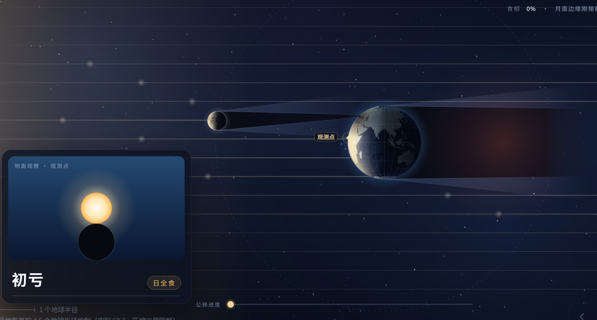

# 月面环形山与陨石坑实验流程（会议确认版）

依据 2026\-10\-28 会议原始逐字稿、2026\-11\-04 补充讨论及 2026\-11\-10 已实现能力确认整理。

## 月面环形山高度测量

### 数据与交互流程

* [x] 左侧显示环形山俯视／月面图，右侧显示对应侧剖面。

1. 学生在左侧选点，系统根据程序化坑体实时生成对应连续剖面，并同步标记右侧位置。 // 交互调整，区分拖拽剖切面和选择测量点两个行为

2. 调整太阳入射角，俯视阴影与剖面光线同步变化。// 背景全屏

3. 点击“测量影长”：从**测量点**垂直投影至**阴影端点拉线**，显示影长、厘米刻度和比例尺。 // 在左侧操作，标注同步在右侧显示，不需要用户自己手算，用动效呈现

4. 点击“计算高度”：按影长、太阳入射角和三角形关系计算并显示结果。

### 已确认约束

- 实际选点和影长测量在左侧月面图完成；右侧剖面用于同步演示三角形原理。

- 坑体采用程序化建模，剖面按选点位置连续生成；不设预设切面个数，也不使用最近切面吸附。

- 手绘灰白月面；只显示平行光线，不绘制太阳实体。

- 单页完成，四周留余量，不依赖页面滚动。

### 待确认

- 高度计算的正式公式及局部基准面。

- 太阳高度角的坐标定义与有效范围。

- 影长精度、误差规则和参考答案展示方式。

## 陨石坑撞击

### 数据与交互流程

5. 选择地球或月球场景。

6. 依次完成三个独立小实验，每次只改变一个变量：

|步骤|唯一变量|档位|
|---|---|---|
|1|陨石大小|小、中、大|
|2|进入速度|低、中、高|
|3|入射角|90°、45°、30°|

7. 发射后播放陨石进入与撞击过程：地球表现大气摩擦，月球直接撞落。

8. 撞击结束后同时显示俯视和剖面结果。

9. 用“大／中／小、深／浅、圆／不规则、溅射范围”等定性结果说明差异。

10. 自动记录本轮条件与结果；进入下一步时重置其他变量。

### 已确认约束

- 采用控制变量法，不开放多个变量自由组合。

- 地球与月球在同一组参数下进行比较。
