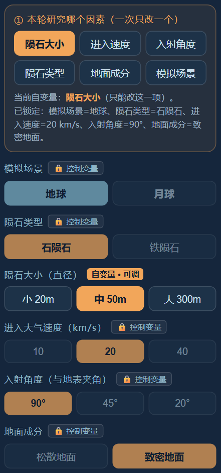
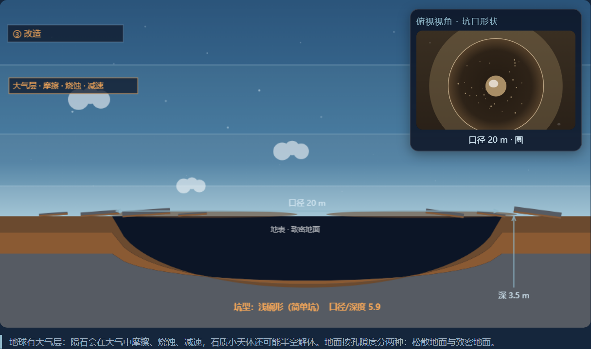
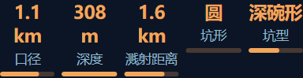

# 陨石坑撞击实验 — 页面功能规格

## 一、实验目标与组成

实验分为三部分：**改变陨石大小、改变进入速度、改变入射角**。地球与月球对比贯穿三部分。

要说明：撞击条件会影响坑的大小、深浅、形状和溅射；大气会改变落地前的运动与撞击结果；通过每次只改变一个条件，比较并解释结果。

面向学生展示定性分档，避免把精确物理数值直接当作学习目标。配图只说明界面组织，必须实现的功能和数据以正文为准。

## 二、第一部分：改变陨石大小

原理：在其他条件相同时，不同大小的撞击体产生不同的坑。

必须实现：提供小、中、大三档，陨石外形随档位变化；速度固定在中档、入射角固定90°。选择后发射、播放撞击并显示结果；允许重试和对比。

必须展示：本轮研究因素、大小档位、已固定条件，以及坑的大小、深浅、形状结论。

*图1｜一次只开放本轮研究的参数，其余锁定。图中额外的类型、地面等控件不自动成为必须新增的实验步骤。*

## 三、第二部分：改变进入速度

原理：速度变化会改变撞击效果。

必须实现：提供低、中、高三档，其他条件固定；发射后表现坑大小、深浅和溅射的定性差异。可查看本部分的多次结果。

必须展示：速度档位、其他固定条件、坑的大小与深浅、溅射表现；记录本轮改变了速度。

## 四、第三部分：改变入射角

原理：不同入射方向影响坑形与溅射方向。

必须实现：提供90°、45°、30°三档，其他条件固定；显示入射方向和撞击过程，并呈现可解释的坑形与溅射方向差异。

必须展示：入射角、方向、坑形（圆、近圆或椭圆）和溅射分布。画面与计算结果对应，不强行把所有斜撞都画成椭圆。

## 五、地球与月球对比

原理：地球有大气层，陨石会减速、消融，部分条件下可能空爆；月球没有同样的大气过程。

必须实现：

1. 提供地球、月球场景，可在相同撞击条件下切换或并排比较。
2. 地球表现大气层及穿越时的发光、减速；月球直接撞击，不加大气摩擦效果。
3. 两种地表质感不同，结果给出差异的教学解释。
4. 对比时保留条件，明确环境差异；不得将同时改变多个条件的结果当作单变量结论。

必须展示：当前场景、有无大气、撞击条件和结果差异。无需把精确大气密度作为学生读数。

*图2｜主画面看剖面深浅，右上窗口看坑口形状。图中数值为演示输出，最终学生界面显示定性结论；剖面不可直接当等比例图量取深径比。*

## 六、结果与数据呈现

### 必须实现的结果画面

- 每次完成后同时提供俯视和侧视或剖面，配简短文字结论。
- 至少清楚区分坑的大小、深浅、圆或不圆及溅射范围。
- 底层复用计算模型生成结果，学生界面采用定性分档；同一条件重复实验结果一致。
- 每个开放选项都必须能得到结果，不能出现可点击但无反应的档位。

### 必须展示的数据

| 显示位置 | 内容 |
|---|---|
| 当前条件 | 研究因素、场景、陨石大小档位、速度档位、入射角；固定条件明确标示 |
| 学生结果 | 坑的大小、深浅、坑形、溅射范围及简短解释 |
| 教师展开数据 | 口径、深度、溅射距离、坑形、坑型；如显示深径比，明确是深度÷口径，不与倒数混用 |
| 对比说明 | 进入速度与落地速度的区别；大气影响与其他条件变化分开说明 |

*图3｜口径、深度、溅射、坑形、坑型的排列示意。定量信息用于展开数据区，学生默认画面不照搬这一组数值。*

## 七、实验记录与课程衔接

必须实现：每次撞击自动增加记录；可查看、可清除上一条，跨步骤保留。用高亮或文字明确本轮改变的唯一因素。

必须记录：轮次、研究因素、场景、大小档位、速度档位、入射角、结果结论。若开放地面条件，记录对应条件；不要求照搬示例表的所有列。

*图4｜条件与结果并列记录的示意。两行中场景与靶材均有变化，不能仅凭这两行把全部结果差异归因于大气。*

与月面环形山高度测量页面采用一致的画风、标尺、按钮和坑形命名，使撞击形成坑与测量坑的学习过程相衔接。

## 八、全局要求与范围

- 采用分步教学，不开放多个变量同时自由组合；切换步骤时显示当前开放变量。
- 关键按钮与文字在学校显示屏完整可见；重试和返回操作明确。
- 不要求导出文件、跨账号保存或精细粒子特效。
- 地面材质是否另设一步、是否加入石铁陨石选择、是否讲解中央隆起仍待确定；这些扩展不替代现有三部分。
