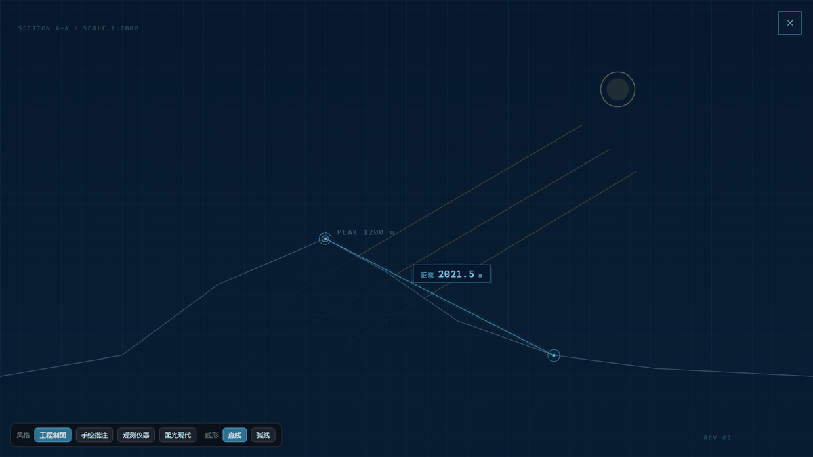
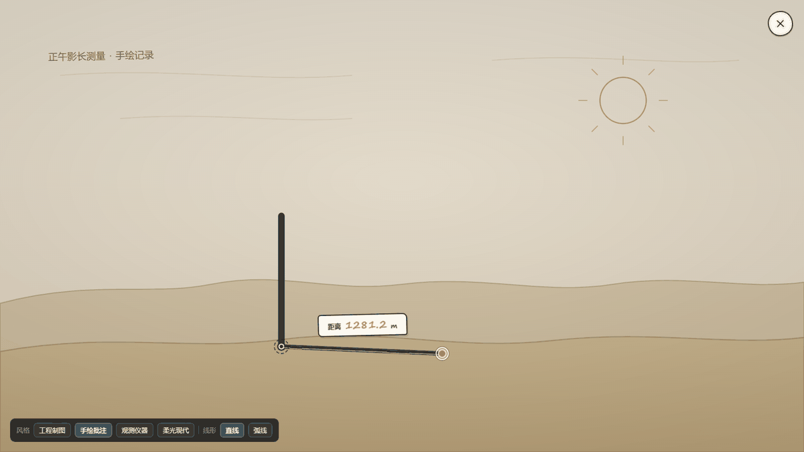
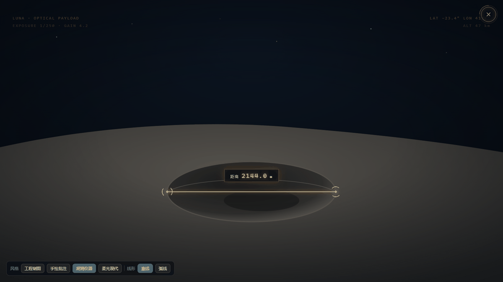
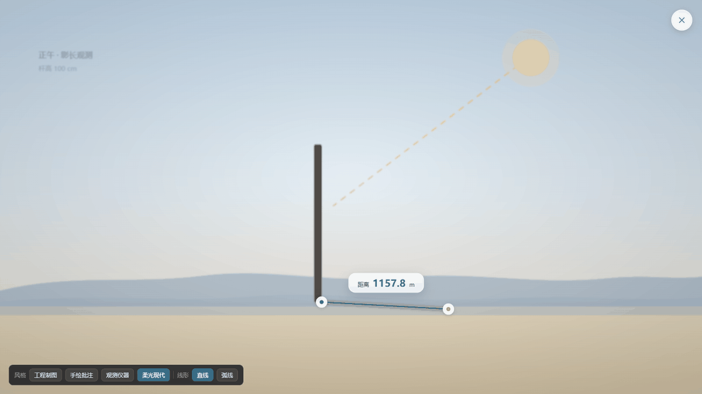
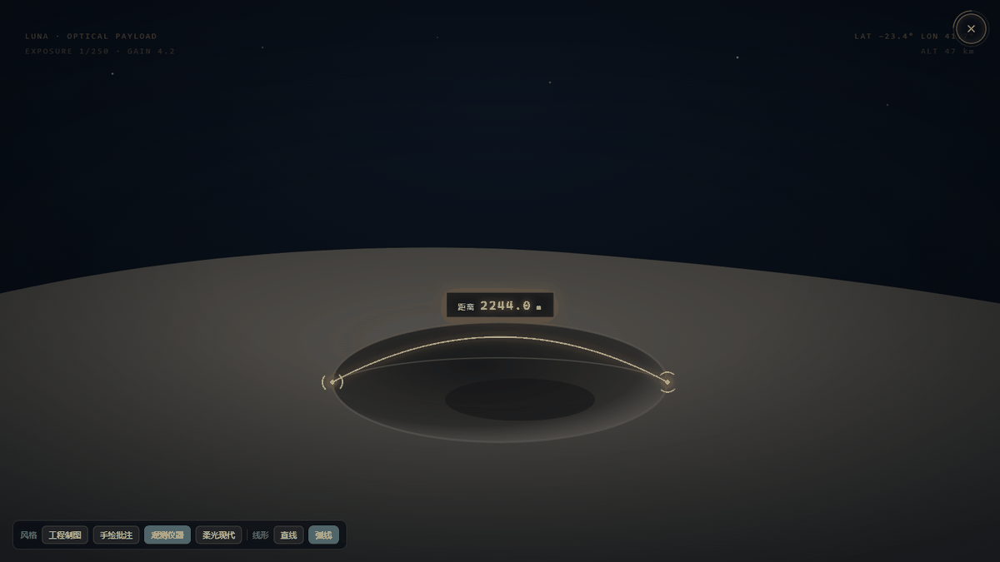

# MeasureMode 测量模式

在宿主给定的测量画面（Viewport）上叠一层测量交互：进入测量 → 扫描 → 取起点 → 取终点 → 虚线预览与确认 → 描线 → 显示长度。画面、单位、数值来源都由宿主提供，组件不判断测什么、也不参与科学计算。

状态：**试验中**。当前无实验接入；预览中的场景配色和单位只是示例。

## 加载

```html
<link rel="stylesheet" href="../../shared/components/measure-mode/measure-mode.css">
<link rel="stylesheet" href="../../shared/components/measure-mode/skins/soft.css">

<script src="../../shared/components/measure-mode/measure-mode.js"></script>
```

`measure-mode.css` 只负责结构与定位，必须加载；再按实验配色选一个皮肤文件（可只加载一个，也可同时加载后切换 `body` 上的 `style-*` 类）。

```js
const measure = SharedComponents.MeasureMode(stageElement, {
  label: '影长',
  unit: 'cm',
  pxPerUnit: 0.62,     // 画面像素 → 显示单位
  decimal: 1,
  shape: 'straight',   // 'straight' | 'arc'
  arcSag: 0.18,
  arcSide: 1
});

// 宿主自行决定何时进入测量模式；也可以让用户点组件自带的角标按钮。
measure.enter();
measure.exit();
measure.destroy();
```

宿主元素需要能被点击（组件会把 `position: static` 改为 `relative`）并在视觉上代表一个 Viewport。组件在宿主内插入自己的覆盖层和 SVG 连线，不改动宿主原有子节点。

## 交互阶段

`idle → scanning → pickStart → pickEnd → pending → committing → done`

| 阶段 | 画面 | 点击行为 |
| --- | --- | --- |
| `scanning` | 全画面扫描动效 | 不响应 |
| `pickStart` | 提示「点击测量起始点」 | 落起点，进入 `pickEnd` |
| `pickEnd` | 提示「选择测量结束点」 | 落终点，进入 `pending` |
| `pending` | 闪动半透明虚线 + 终点旁的圆形确认按钮 | 点别处改终点，点确认进入 `committing` |
| `committing` | 从起点描线到终点 | 不响应 |
| `done` | 显示长度读数 | 可重新进入测量 |

测量模式下右上角图标自动变为关闭按钮（`data-phase` 驱动，见 `measure-mode.css`）。单击坐标会按宿主的 CSS 缩放比换算回画面坐标，实验页面整页 `scale()` 缩放到白板时不会偏移。

## 配置

| 参数 | 默认 | 说明 |
| --- | --- | --- |
| `label` | `长度` | 读数前的文字 |
| `unit` | `cm` | 读数单位，宿主可换成 `m`、`km` 等 |
| `pxPerUnit` | `0.5` | 画面像素到显示值的线性比例 |
| `decimal` | `1` | 小数位 |
| `format(px)` | 无 | 自定义换算：返回 `{ value, unit, decimal }`；曲线长度、透视修正等由宿主决定时用它，优先于 `pxPerUnit` |
| `scan` | `900` | 进入测量后的扫描时长（毫秒） |
| `shape` | `straight` | `straight` 为弦；`arc` 沿弦法线鼓出弧线，适合球面边缘、坑缘等曲面标注 |
| `arcSag` | `0.18` | 弧高 = 弦长 × `arcSag` |
| `arcSide` | `1` | 弧向弦的哪一侧鼓，取 `1` 或 `-1` |

弧线读数按弧长计算（三次贝塞尔 32 段采样），不是弦长，因此切到弧线后数值会变大。

## 实例方法

| 方法 | 说明 |
| --- | --- |
| `enter()` | 进入扫描并开始一次新测量；清掉上一次结果 |
| `exit()` | 关闭测量模式，回到 `idle` |
| `destroy()` | 移除覆盖层、事件与计时器 |
| `setShape('straight'｜'arc')` | 切换线形；已完成的读数随之重算 |
| `getLength()` | 当前连线长度（画面像素；弧线为弧长） |
| `getPoints()` | `{ start, end }`，未取点时为 `null` |
| `getShape()` | 当前线形 |
| `state` / `root` | 调试用：内部状态与覆盖层根节点 |

组件不回调业务结果；确认后的数值由宿主在需要时读取 `getLength()`，或直接用 `format` 控制显示。

## 皮肤

皮肤只改视觉，不改交互。每个皮肤文件都限定在自己的 `style-*` 类下，可以同时加载。

| 皮肤 | 文件 | 气质 |
| --- | --- | --- |
| 工程制图 | [skins/blueprint.css](skins/blueprint.css) | 青色细线、制图网格、机械感扫描 |
| 手绘批注 | [skins/ink.css](skins/ink.css) | 纸面铅笔抖动线、手写标签、橙色端点 |
| 观测仪器 | [skins/hud.css](skins/hud.css) | 琥珀准星、扫描线与仪器角标 |
| 柔光现代 | [skins/soft.css](skins/soft.css) | 磨砂玻璃控件、柔和扫光，最接近现有页面 |









弧线沿坑缘标注：



独立预览：[previews/components/measure-mode.html](../../../previews/components/measure-mode.html)，左下角可切换皮肤与线形。

## 边界

- 组件不画场景、不决定可测对象；宿主提供 Viewport 与背景画面。
- 组件不计算科学结果；`pxPerUnit` 只是默认线性换算，复杂换算请用 `format`。
- 组件不判断“测量是否合格”、不推进课程阶段；`enter/exit` 由宿主触发。
- 组件不读取实验 DOM 或全局课程状态，不向 `window` 暴露除 `SharedComponents.MeasureMode` 以外的名字。
- 皮肤色值只是默认皮肤；实验配色通过新增皮肤文件或覆盖 `--ac` 等变量表达，不往组件里塞全站主题。
- 减少动态效果模式下，扫描、闪动与描线缩短为瞬时完成（`prefers-reduced-motion`）。
